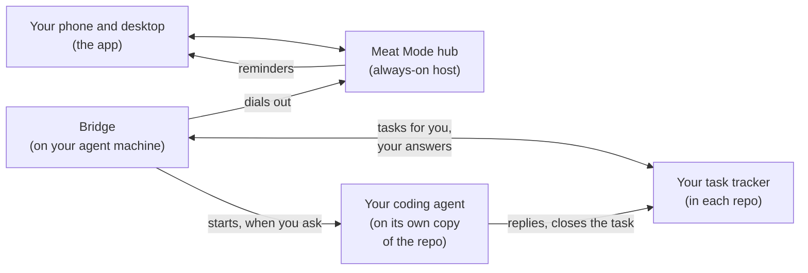
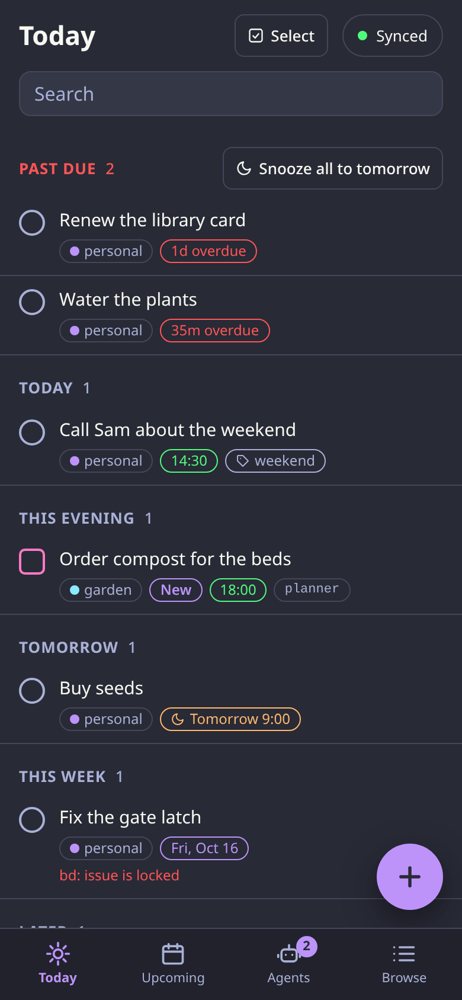
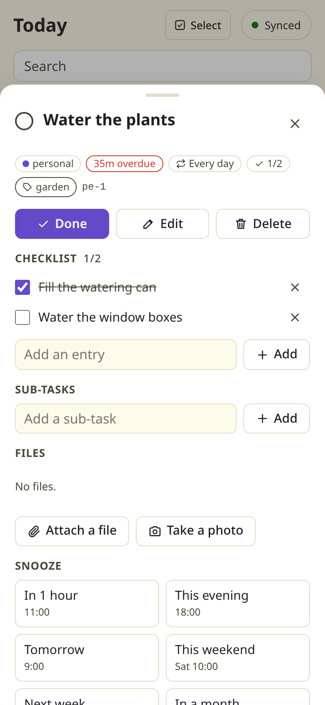
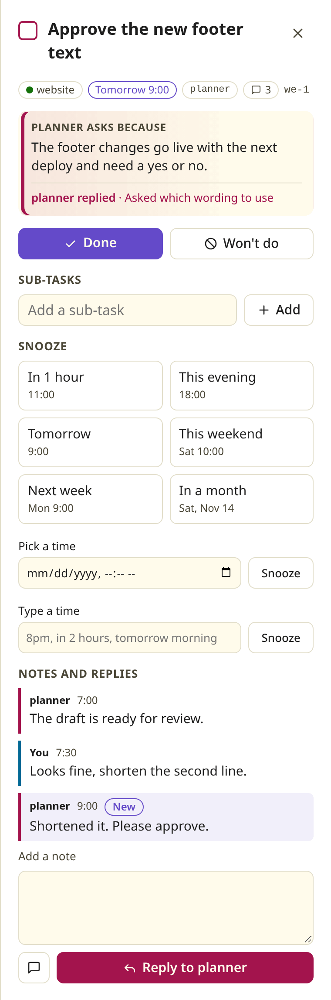
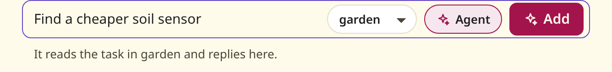
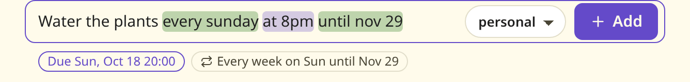
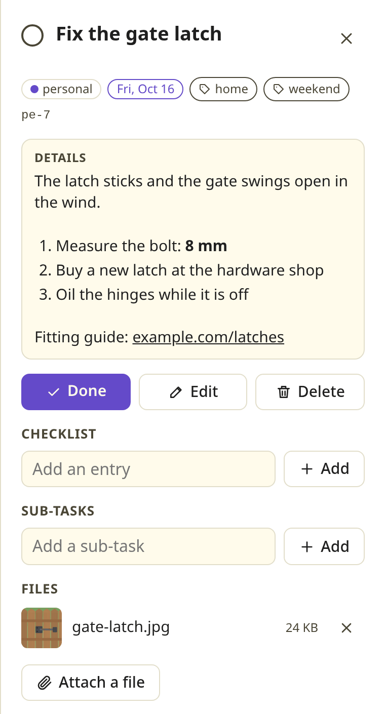
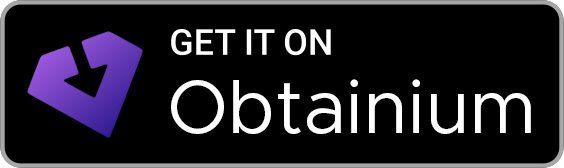

<!--
Style guide for this page.
- Reader: someone deciding whether to self-host Meat Mode, often not a Go or web developer. Within one screen they learn what it is (one to-do list for their own tasks and the ones their AI agents raise), who it is for, and how it helps.
- Voice: say "you", short sentences, present tense, no em dashes, no history or "new". Lead with what it does for the reader; the machinery (hub, bridge, SQLite, Web Push) comes after, and each project term is explained in everyday words the first time.
- Public repo: invented examples only (Alex, Sam, example.com, "Water the plants"). Deployment wording stays generic: "an always-on host", "a Tailscale Service", never one operator's names, paths or ports.
- Shape: name and bold line, screenshot, picture of how it fits, why it exists, what you can do (one heading and one picture or example each), what it works with (a tracker table and a harness table), is this for you, start here table, reference (getting started, contributing, licence).
- Setup detail lives in docs/deploy.md and the wire contract in docs/api.md; link to them, do not copy. The wizard step list under "Get started" follows web/src/wizard/steps and the step table in docs/deploy.md.
- Images live in docs/images/ and show invented data only. They come from the web test fake hub (web/test/e2e/fake-hub.ts) and its fixed clock, shot with a throwaway Playwright spec (not committed) at deviceScaleFactor 2, phone 390x844 and desktop 1280 wide, with element shots of the new task bar (#qa-form) and the detail pane (#detail), and reduced to 8-bit PNGs (ImageMagick `+dither -colors 256 PNG8:` does it); they are not the visual test baselines. Light shots set `meat-mode.theme` to `light` in localStorage before the page loads. Extra fixture data (a repeat, a checklist, tags, a Markdown description, an attachment drawn for the purpose rather than a real photo) goes in the throwaway spec, not in the fake hub. The agent images set runs with the fake hub's allowAgents and setRun. A tall detail pane is shot in a taller viewport and cropped below its last section in view, and the month view is cropped to the sidebar and the month, leaving out the empty detail pane. The images: desktop-today-detail, phone-today-dark, phone-detail, agent-run-sheet, new-task-agent, quick-add-repeat, details-files and month-view. Retake them when the screens they show change, and give each alt text that says what it shows.
- Private network only: the hub is reached over Tailscale (Serve or a Tailscale Service) or a LAN reverse proxy, never the internet, and always has a password; the hub refuses internet requests and the bridge refuses a public hub. Login, session limits and password-again rules follow docs/api.md "Login". Never suggest Funnel, Cloudflare Tunnel, port forwards or a public calendar feed; detail lives in docs/deploy.md, "Private network only".
- Agent runs: keep the "This is not a sandbox" caution in "Hand a task to an agent" whenever that section exists. Limits and defaults quoted there follow the table in docs/deploy.md, "Wake an agent on a task".
- Android app: the install section is short: the badge first, one paragraph, then a collapsed details block for adding it by hand and checking it. It names the Obtainium badge link, APK filter and package ID. The badge link is an apps.obtainium.imranr.dev redirect carrying an obtainium://app/ config (double URL-encoded) with the APK filter and the certificate SHA-256; rebuild it when either changes. The badge image is Obtainium's assets/graphics/badge_obtainium.png, trimmed; keep them in step with docs/api.md "Android app" and docs/android-release.md. The certificate line holds the release key's SHA-256 and changes only with the key.
- "What it works with" follows the tables in docs/trackers.md and docs/harnesses.md and each tracker's `Actions` and each harness's `Info()` in the code; update it when a tracker or harness is added or changes what it supports.
- Nothing else in the repo depends on this page's headings. The Start here links depend on docs/deploy.md's headings.
-->
# Meat Mode

**One to-do list for the things only you can do: your own to-dos and the tasks your AI agents hand you, on your phone and your desktop.**


Your AI agents keep their work in an issue tracker that lives in your code repos, such as [beads](https://github.com/gastownhall/beads). When an agent needs you for something it cannot do itself (approve a text, sign in somewhere, make a call), it files a task labelled `human`. Meat Mode gathers those tasks from every repo and every machine into one list, next to your own to-dos. You tick them off, snooze them, say no, or reply with a note, and your answer goes back to the agent in its tracker. In the repos you allow, one tap also wakes an agent to work on a task, and you watch how it goes on the task itself.

beads is the example on this page. Meat Mode reads Backlog.md and ticket repos the same way, and runs Claude Code, Codex, OpenCode, Antigravity CLI or Pi as the agent: see [What it works with](#what-it-works-with).

You host it yourself. It runs as one container on any always-on machine you have, such as a home server, a NAS or a Raspberry Pi, so your list and your reminders keep working while the computer your agents run on is asleep. It stays on your private network, your tailnet or your home LAN, refuses requests from the internet, and always asks for a password.

## How it fits together



- **The hub** keeps your list, sends reminders and serves the app. Your personal to-dos need nothing else.
- **The bridge** is a small background service on the machine your agents use. It finds the repos where your agents track their work, whichever tracker each one uses, sends the tasks marked for you up to the hub and plays your answers back into that tracker. When you ask, it starts the coding agent that machine is set to run, on a task in a repo you allowed; the agent replies and closes the task in the tracker, as it would on its own. It always connects out to the hub, so the hub never reaches into your agent machine.

## Why it exists

- Agents ask for your help inside the repo they work in. With several projects you end up checking each one, or missing what they asked.
- A request in a terminal is easy to lose. A task with a due date and a reminder on your phone is not.
- Your own errands and your agents' requests compete for the same time, so they belong on one list.

## What you can do

### Answer your agents from your phone

Each task from an agent shows why the agent needs you, which project it came from and the conversation so far. Tap **Done** or **Won't do**, snooze it to tonight or next week where its tracker can, or leave a note. The agent reads your note in its tracker, signed with your name, and can reply. Only the repos you switch on in Settings send tasks.

<p>
  
  
</p>

### Hand a task to an agent

When a task is work an agent can do, wake one from the app. Write a note and tap **Save and ask agent**. The agent reads the task and your notes, then does the work and closes the task, or replies with a question. The task's card shows how it is going:

| The card shows | What you can do |
|---|---|
| **working**, with what the agent is doing | **Send to** the agent: a note it reads at its next step, or when its turn ends on some harnesses. **Stop** the run. |
| **waiting** on you, after the agent replied | **Reply to** the agent. Your reply wakes it again. |
| **done**, when the agent closed the task | Nothing; it is off your list. |
| **stopped**, with the reason (you stopped it, a time, budget or usage limit, an error) | **Retry**. |

When you add a task to a list where agents may work, the **Agent** button in the new task bar hands it straight to an agent. It starts off every time. **Stop all** in Settings ends every run at once. When a run you did not stop ends, you get one notification saying the agent replied, finished or stopped, with **Reply** and **Open** buttons.

<p>
  
  
</p>

Agents work only where you let them. They start off in every repo, and you switch them on at the agent machine itself, with `meat-mode bridge agents on <repo>`; the app shows that command and can switch agents off again, but never on. Only your own taps start an agent, and personal to-dos have none. The bridge runs one agent per task, by default Claude Code, or another of the [harnesses below](#what-it-works-with), and gives each task its own Git worktree (a separate checkout of the repo). It stops a run after 30 minutes, or at $2 of usage on a harness that reports its cost, and allows 10 runs per task and 2 at once on the machine; you can change each limit.

> **This is not a sandbox.** The default agent runs commands as you, in your home folder, with your credentials, and asks no permission first. It is told never to send, post, spend, delete or push for you, but nothing enforces that. Switch agents on only in repos where you would let an agent work unattended. Setup, limits and where runs keep their files: [Wake an agent on a task](docs/deploy.md#wake-an-agent-on-a-task).

### Type a to-do the way you would say it

Quick add reads dates, times and repeats as you type and shows you what it understood before you press Enter. "Water the plants every sunday at 8pm until nov 29" becomes a weekly to-do with an end date. Add `#garden` to put it on another list and `@weekend` to give it a tag. Tags show as chips on the row, and you can filter the list by one or search for it. An agent's task shows the labels its tracker gives it, read-only.



Break a bigger task into sub-tasks from its details, on your own to-dos and on an agent's tasks alike. "Plan the party" shows "Send invitations" and "Book a cake" under it in the list, and a dated sub-task brings its parent onto Today. The parent cannot be marked done until every sub-task is done or deleted, and **Delete** or **Won't do** on the parent takes its open sub-tasks with it. Sub-tasks go one level deep. To move one of your to-dos under another, or back to the top, pick it in **Sub-task of** when you edit it. When a repeating parent is done, its done sub-tasks open again for the next date. On an agent's task, a sub-task is a child issue in its tracker, so the agent sees it too.

### Keep the details with the task

Descriptions and notes show as Markdown, so an agent's checklist, table or link reads as it meant it. Editing stays plain text.

On your own to-dos and projects you can attach files: a photo of the broken part, the PDF of the booking. Photos show as thumbnails and open in a tab; other files download. A file can be up to 25 MB, an item holds 20, and the hub keeps up to 1 GB in all. Agents' tasks take no files, since their trackers have nowhere to carry one back to the agent.



### Plan your month

Switch **Upcoming** from **List** to **Month** to see each day's dated items, with repeating to-dos on every later date of their series. To move something to another day, drag it on a desktop, or pick the day in **Move**, which a long press opens on a touch screen. Your own to-do keeps its time of day on its new date. An agent's task moves by a snooze, where its tracker can snooze.


### Take your data with you

**Settings**, **Your data**, **Download your data** gives you one zip file with your list, your projects, their files, the history of changes and your settings. Setup on a fresh hub loads it back, on the same host or another. Agents' tasks are not in it: their trackers keep them, and they come back once you pair the machine again. [Back up](docs/deploy.md#back-up) says what the file holds.

### Get reminded on every device

A reminder comes at the due time and when a snooze ends, as a notification on each phone and computer you turned them on for, and through [ntfy](https://ntfy.sh) if you use it. You can ask for an early reminder too, up to a week ahead. A reminder for one to-do has **Done** and **Snooze 1 hour** buttons that act without opening the app. If the hub was off when something came due, it catches up when it is back. **Settings**, **Devices** lists every browser and phone that gets reminders, and you can revoke any of them.

### Let agents put things on your list

An agent can add a to-do for you with one command on a paired machine, with a date read in your time zone:

```sh
meat-mode add "Renew the library card" --due 2026-03-02 --tag errands --note "It expires on Friday."
```

The same command can add a sub-task under one of the agent's own to-dos with `--parent`, and `meat-mode edit` changes the to-dos that machine added.

Setup gives you a short instruction text to paste into your agents' instruction file, so they know how to raise a task for you.

### See it in your calendar

Turn on the calendar feed and subscribe to it in Apple Calendar, Thunderbird or another calendar app on your own devices, and your dated to-dos show up there while that device is on your network. The feed is read-only. Google Calendar and Outlook on the web fetch feeds from their own servers, so they cannot reach your hub.

### Use it as an Android app

<a href="https://apps.obtainium.imranr.dev/redirect?r=obtainium%3A%2F%2Fapp%2F%257B%2522id%2522%253A%2522io.github.yourfriendaaron.meatmode%2522%252C%2522url%2522%253A%2522https%253A%252F%252Fgithub.com%252Fyourfriendaaron%252Fmeat-mode%2522%252C%2522author%2522%253A%2522yourfriendaaron%2522%252C%2522name%2522%253A%2522Meat%2520Mode%2522%252C%2522additionalSettings%2522%253A%2522%257B%255C%2522apkFilterRegEx%255C%2522%253A%255C%2522meat-mode-android-.*%255C%255C%255C%255C.apk%255C%2522%252C%255C%2522allowedSigningCertHashes%255C%2522%253A%255C%2522D9%253A96%253ACE%253A79%253AAB%253A03%253ABC%253A39%253A67%253A5C%253A6F%253A69%253A09%253AED%253A88%253A87%253A7F%253A2C%253ACA%253A12%253AB5%253A79%253A36%253A09%253A28%253A75%253AD0%253A68%253AFF%253A65%253A39%253A90%255C%2522%257D%2522%257D"></a>

With [Obtainium](https://obtainium.imranr.dev) on your phone, tap the badge there to install the app and keep it updated. It shows the same screens as your browser and delivers reminders with **Done** and **Snooze** buttons. Reminders need Google Play Services or a [UnifiedPush](https://unifiedpush.org) app such as [ntfy](https://ntfy.sh).

<details>
<summary>Install by hand, or check the app</summary>

- In Obtainium, **Add App** `https://github.com/yourfriendaaron/meat-mode` with the APK filter `meat-mode-android-.*\.apk`.
- Or download `meat-mode-android-vX.Y.Z.apk` from the [releases page](https://github.com/yourfriendaaron/meat-mode/releases).
- Check it with [AppVerifier](https://github.com/soupslurpr/AppVerifier): package `io.github.yourfriendaaron.meatmode`, certificate SHA-256:

  ```
  D9:96:CE:79:AB:03:BC:39:67:5C:6F:69:09:ED:88:87:7F:2C:CA:12:B5:79:36:09:28:75:D0:68:FF:65:39:90
  ```

</details>

## What it works with

The bridge reads the task trackers your agents already use. Each repo is read by its own tracker, and the app hides what that tracker cannot do.

| Tracker | Your agent marks a task for you with | What you can do with its tasks |
|---|---|---|
| [beads](docs/trackers/beads.md) | the label `human` | everything: done, won't do, snooze, notes, sub-tasks, wake an agent |
| [Backlog.md](docs/trackers/backlog.md) | the label `human` | everything except snooze |
| [ticket](docs/trackers/ticket.md) | the tag `human` | everything except snooze |

When you wake an agent, the bridge starts one of these coding agents (the docs call them harnesses). Each machine runs one, Claude Code unless you pick another.

| Harness | Stops at your spending cap | A note you send while it works | Reads standing instructions from |
|---|---|---|---|
| [Claude Code](docs/harnesses/claude.md) | yes | reaches it at once | `CLAUDE.md` |
| [Codex](docs/harnesses/codex.md) | no, the time limit only | waits for its turn to end | `AGENTS.md` |
| [OpenCode](docs/harnesses/opencode.md) | yes | waits for its turn to end | `AGENTS.md` |
| [Antigravity CLI](docs/harnesses/antigravity.md) | no, the time limit only | reaches it at once | `AGENTS.md` |
| [Pi](docs/harnesses/pi.md) | yes | reaches it at once | `AGENTS.md` |

Settings shows each machine's tracker and harness with their versions. Adding another is one Go package: [docs/trackers.md](docs/trackers.md) and [docs/harnesses.md](docs/harnesses.md) give the steps.

## Is this for you?

It fits if:

- You work with AI coding agents that track their work in beads, Backlog.md or ticket, or you want a plain self-hosted to-do list you can grow into that later.
- You have, or are happy to set up, an always-on machine that runs containers.
- You can reach it over [Tailscale](https://tailscale.com), or through a reverse proxy on your home LAN with an HTTPS certificate. Phone notifications and installing the app need HTTPS.

It is not:

- A shared or team list. It has one user.
- A hosted service. You run it yourself.
- Something to put on the internet. It answers only on your private network, so Tailscale Funnel, Cloudflare Tunnel and router port forwards are out. The hub refuses requests from the internet, and the bridge refuses a hub at a public address.
- A project tracker. Agents keep their own work in their tracker; Meat Mode shows only the tasks that need you.

## Start here

| If you want to | Read |
|---|---|
| Install the Android app | [Use it as an Android app](#use-it-as-an-android-app) |
| Run the hub and set it up | [docs/deploy.md](docs/deploy.md) |
| Connect the machine your agents run on | [Install the bridge](docs/deploy.md#3-install-the-bridge-on-the-agent-machine) and [Pair](docs/deploy.md#4-pair) |
| Let an agent work on a task you hand it | [Wake an agent on a task](docs/deploy.md#wake-an-agent-on-a-task) |
| Choose which coding agent runs a task | [docs/harnesses.md](docs/harnesses.md) |
| Use Backlog.md or ticket, or add a tracker | [docs/trackers.md](docs/trackers.md) |
| Let agents add to your list from scripts | [Let agents add to your personal list](docs/deploy.md#let-agents-add-to-your-personal-list) |
| Back up, or move to another host | [Back up](docs/deploy.md#back-up) |
| Put it at your own domain on your LAN | [Behind a reverse proxy](docs/deploy.md#behind-a-reverse-proxy) |
| Know what keeps it off the internet | [Private network only](docs/deploy.md#private-network-only) |
| Build against the hub's API | [docs/api.md](docs/api.md) |
| Know why it is built this way | [docs/decisions](docs/decisions) |

## Get started

Start the hub container ([docs/deploy.md](docs/deploy.md#1-run-the-hub)) and open it in your browser. The first visit asks for a one-time setup code, which the hub prints in its log, and the password you choose; until then the hub shows nothing else. Then setup walks you through the rest:

1. **Connection check**: is the app reached the way the hub expects, so reminders and live updates work, and does the internet not know its name?
2. **Secure the hub**: confirms the hub has its password.
3. **Restore from an export** (fresh hub only): load a file from **Download your data** to bring your list back.
4. **Name and time zone**: the name your notes are signed with, and the zone your agents' dates are read in.
5. **Install the app** to the home screen or dock. On an iPhone or iPad, reminders need the Home Screen app.
6. **Reminders**: allow notifications and get a test reminder on this device, and on ntfy if you use it.
7. **Appearance**: dark, light, or follow the device.
8. **First to-do**: type `Water the plants tomorrow 6pm` and watch quick add read the date.
9. **Agent machines** (optional): pair the machine your agents work on (it asks for your password again unless you entered it in the last 10 minutes), choose which repos show up, see the command that lets agents work in one, and copy instructions that tell your agents how to raise tasks for you.

Skip any step; each one is also in Settings, where you can run setup again. Other devices get just the device steps.

Each device logs in with your password. A login lasts until it goes unused for 14 days, and 90 days at most. Changing the password takes the current one.

## Contributing

Run `scripts/setup.sh` after cloning. This repo is public; read `AGENTS.md` before committing anything.

Toolchain versions are pinned in `mise.toml` (Go, Node, pnpm). Maintainers set up the Android signing key with [docs/android-release.md](docs/android-release.md). The web app picks every colour by what it means; see [docs/design-tokens.md](docs/design-tokens.md).

```sh
pnpm --dir web install && pnpm --dir web build   # frontend into web/static
go test ./...                                     # hub, bridge, reminders
pnpm --dir web test && pnpm --dir web test:e2e    # frontend unit and browser tests
go build ./cmd/meat-mode                          # one binary: hub and bridge
```

Tests:

- `go test ./...` for the hub and the bridge.
- `pnpm --dir web test` for frontend modules, and `pnpm --dir web test:e2e` for the UI against a fake hub.
- `pnpm --dir e2e test` for the end-to-end suite: the app in Chromium, a real hub, two bridges and scratch beads repos in a temp directory. It needs Go, `pnpm install` in both `web/` and `e2e/`, and `bd` 1.3 or newer on `PATH`; without `bd` it skips. Set `E2E_IMAGE=<image>` to run the hub from a built image (`docker build -t meat-mode:dev .`) instead of the binary.
- `scripts/check.sh` runs everything CI runs.

## License

[MIT](LICENSE)
