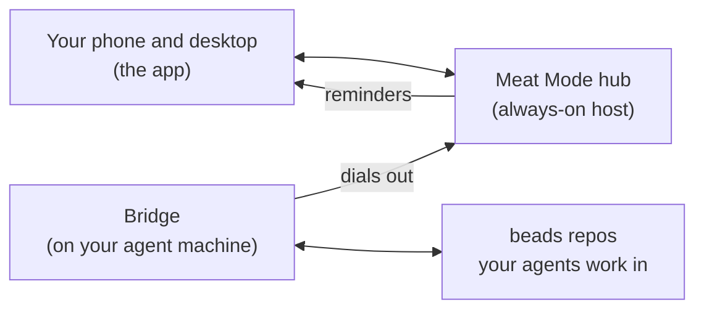

<!--
Style guide for this page.
- Reader: someone deciding whether to self-host Meat Mode, often not a Go or web developer. Within one screen they learn what it is (one to-do list for their own tasks and the ones their AI agents raise), who it is for, and how it helps.
- Voice: say "you", short sentences, present tense, no em dashes, no history or "new". Lead with what it does for the reader; the machinery (hub, bridge, SQLite, Web Push) comes after, and each project term is explained in everyday words the first time.
- Public repo: invented examples only (Alex, Sam, example.com, "Water the plants"). Deployment wording stays generic: "an always-on host", "a Tailscale Service", never one operator's names, paths or ports.
- Shape: name and bold line, screenshot, picture of how it fits, why it exists, what you can do (one heading and one picture or example each), is this for you, start here table, reference (getting started, contributing, licence).
- Setup detail lives in docs/deploy.md and the wire contract in docs/api.md; link to them, do not copy. The wizard step list under "Get started" follows web/src/wizard/steps and the step table in docs/deploy.md.
- Images live in docs/images/ and show invented data only. They come from the web test fake hub (web/test/e2e/fake-hub.ts), shot with Playwright at deviceScaleFactor 2 and reduced to 8-bit PNGs; they are not the visual test baselines. Retake them when the screens they show change, and give each alt text that says what it shows.
- Nothing else in the repo depends on this page's headings.
-->
# Meat Mode

**One to-do list for the things only you can do: your own to-dos and the tasks your AI agents hand you, on your phone and your desktop.**


Your AI agents work in [beads](https://github.com/gastownhall/beads), an issue tracker that lives in your code repos. When an agent needs you for something it cannot do itself (approve a text, sign in somewhere, make a call), it files a task labelled `human`. Meat Mode gathers those tasks from every repo and every machine into one list, next to your own to-dos. You tick them off, snooze them, say no, or reply with a note, and your answer goes back to the agent in beads.

You host it yourself. It runs as one container on any always-on machine you have, such as a home server, a NAS or a Raspberry Pi, so your list and your reminders keep working while the computer your agents run on is asleep.

## How it fits together



- **The hub** keeps your list, sends reminders and serves the app. Your personal to-dos need nothing else.
- **The bridge** is a small background service on the machine your agents use. It finds your beads repos, sends their `human` tasks up to the hub and plays your answers back into beads. It always connects out to the hub, so the hub never reaches into your agent machine.

## Why it exists

- Agents ask for your help inside the repo they work in. With several projects you end up checking each one, or missing what they asked.
- A request in a terminal is easy to lose. A task with a due date and a reminder on your phone is not.
- Your own errands and your agents' requests compete for the same time, so they belong on one list.

## What you can do

### Answer your agents from your phone

Each task from an agent shows why the agent needs you, which project it came from and the conversation so far. Tap **Done** or **Won't do**, snooze it to tonight or next week, or leave a note. The agent reads your note in beads, signed with your name, and can reply. Only the repos you switch on in Settings send tasks.

<p>
  
  
</p>

### Type a to-do the way you would say it

Quick add reads dates, times and repeats as you type and shows you what it understood before you press Enter. "Water the plants every sunday at 8pm until nov 29" becomes a weekly to-do with an end date. Add `#garden` to put it on another list.


### Get reminded on every device

A reminder comes at the due time and when a snooze ends, as a notification on each phone and computer you turned them on for, and through [ntfy](https://ntfy.sh) if you use it. You can ask for an early reminder too, up to a week ahead. If the hub was off when something came due, it catches up when it is back.

### Let agents put things on your list

An agent can add a to-do for you with one command on a paired machine, with a date read in your time zone:

```sh
meat-mode add "Renew the library card" --due 2026-03-02 --note "It expires on Friday."
```

Setup gives you a short instruction text to paste into your agents' instruction file, so they know how to raise a task for you.

### See it in your calendar

Turn on the calendar feed and subscribe to it in Apple Calendar, Thunderbird or another calendar app, and your dated to-dos show up there. The feed is read-only.

## Is this for you?

It fits if:

- You work with AI coding agents that use beads, or you want a plain self-hosted to-do list you can grow into that later.
- You have, or are happy to set up, an always-on machine that runs containers.
- You can reach it over [Tailscale](https://tailscale.com), or behind a reverse proxy with an HTTPS certificate. Phone notifications and installing the app need HTTPS.

It is not:

- A shared or team list. It has one user.
- A hosted service. You run it yourself.
- A project tracker. Agents keep their own work in beads; Meat Mode shows only the tasks that need you.

## Start here

| If you want to | Read |
|---|---|
| Run the hub and set it up | [docs/deploy.md](docs/deploy.md) |
| Connect the machine your agents run on | [Install the bridge](docs/deploy.md#3-install-the-bridge-on-the-agent-machine) and [Pair](docs/deploy.md#4-pair) |
| Let agents add to your list from scripts | [Let agents add to your personal list](docs/deploy.md#let-agents-add-to-your-personal-list) |
| Put it behind your own domain with a password | [Behind a reverse proxy](docs/deploy.md#behind-a-reverse-proxy) |
| Build against the hub's API | [docs/api.md](docs/api.md) |
| Know why it is built this way | [docs/decisions](docs/decisions) |

## Get started

Start the hub container ([docs/deploy.md](docs/deploy.md#1-run-the-hub)) and open it in your browser. The first visit opens setup, which walks you through the rest:

1. **Connection check**: is the app reached the way the hub expects, so reminders and live updates work?
2. **Secure the hub**: set the password in the browser, with a one-time setup code the hub prints in its log.
3. **Name and time zone**: the name your notes are signed with, and the zone your agents' dates are read in.
4. **Install the app** to the home screen or dock. On an iPhone or iPad, reminders need the Home Screen app.
5. **Reminders**: allow notifications and get a test reminder on this device, and on ntfy if you use it.
6. **Appearance**: dark, light, or follow the device.
7. **First to-do**: type `Water the plants tomorrow 6pm` and watch quick add read the date.
8. **Agent machines** (optional): pair the machine your agents work on, choose which repos show up, and copy instructions that tell your agents how to raise tasks for you.

Skip any step; each one is also in Settings, where you can run setup again. Other devices get just the device steps.

## Contributing

Run `scripts/setup.sh` after cloning. This repo is public; read `AGENTS.md` before committing anything.

Toolchain versions are pinned in `mise.toml` (Go, Node, pnpm).

```sh
pnpm --dir web install && pnpm --dir web build   # frontend into web/static
go test ./...                                     # hub, bridge, reminders
pnpm --dir web test && pnpm --dir web test:e2e    # frontend unit and browser tests
go build ./cmd/meat-mode                          # one binary: hub and bridge
```

Tests:

- `go test ./...` for the hub and the bridge.
- `pnpm --dir web test` for frontend modules, and `pnpm --dir web test:e2e` for the UI against a fake hub.
- `pnpm --dir e2e test` for the end-to-end suite: the app in Chromium, a real hub, two bridges and scratch beads repos in a temp directory. It needs Go, `pnpm install` in both `web/` and `e2e/`, and `bd` 1.3 or newer on `PATH`; without `bd` it skips. Set `E2E_IMAGE=<image>` to run the hub from a built image (`docker build -t meat-mode:dev .`) instead of the binary.
- `scripts/check.sh` runs everything CI runs.

## License

[MIT](LICENSE)
